# EpiSante — Medical Microservices Platform

EpiSante is a production-grade, distributed medical platform inspired by Doctolib. It leverages a modern microservices architecture to ensure high availability, data isolation, and scalable real-time health monitoring.

## Architecture Overview

The platform is designed in two layers. The **microservices core** handles real-time transactional and event-driven flows. The **full platform** extends this with a big data / telemetry layer for long-term analytics.

---

### Microservices & Event-Driven Architecture

The diagram below shows the operational core: the API gateway, transactional backend services, Kafka-driven async workflows, IoT wearable ingestion, and database isolation.

```mermaid
flowchart TD
    %% Define styles for readability
    classDef external fill:#f9f9f9,stroke:#333,stroke-width:2px;
    classDef gateway fill:#cce5ff,stroke:#004085,stroke-width:2px;
    classDef goService fill:#d1ecf1,stroke:#0c5460,stroke-width:2px;
    classDef javaService fill:#d4edda,stroke:#155724,stroke-width:2px;
    classDef kafka fill:#fff3cd,stroke:#856404,stroke-width:2px;
    classDef db fill:#e2e3e5,stroke:#383d41,stroke-width:2px;
    classDef vault fill:#fff3cd,stroke:#ffc107,stroke-width:2px;

    %% External / Clients
    subgraph External [External Actors / Internet]
        Wearables["Medical Wearables / IoT"]:::external
        UI["Browser / React UI"]:::external
    end

    %% Gateway Layer
    subgraph VM_Gateway [VM: Gateway 172.20.0.60]
        Nginx["Nginx API Gateway / Reverse Proxy"]:::gateway
    end

    %% Security Layer
    subgraph VM_Security [VM: Security]
        Vault["HashiCorp Vault"]:::vault
    end

    %% Streaming & IoT Layer
    subgraph VM_Streaming [VM: Streaming 172.20.0.50]
        Ingest["Ingest Wearables Service <br/>(Go)"]:::goService
        KafkaStreams["Kafka Streams App <br/>(Identify Anomalies)"]:::javaService
        AlertEngine["Health Alert Engine <br/>(Go)"]:::goService
    end

    %% Message Broker
    subgraph VM_Kafka [VM: Kafka 172.20.0.70]
        KafkaBroker[("Apache Kafka Topics")]:::kafka
    end

    %% Core Transactional Backend
    subgraph VM_Backend [VM: Backend 172.20.0.20]
        Auth["Auth Service <br/>(Java)"]:::javaService
        Appoint["Appoint Service <br/>(Java)"]:::javaService
        Patient["Patient Service <br/>(Java)"]:::javaService
        Doctor["Doctor Service <br/>(Java)"]:::javaService
        Notif["Notif Service <br/>(Go)"]:::goService
    end

    %% Database Layer
    subgraph VM_Data [VM: Data 172.20.0.40]
        AuthDB[("Auth DB")]:::db
        AppointDB[("Appoint DB")]:::db
        PatientDB[("Patient DB")]:::db
        DoctorDB[("Doctor DB")]:::db
    end

    %% --- CONNECTIONS ---

    %% Client Ingress
    Wearables -->|TCP/MQTT| Nginx
    UI -->|HTTP / REST| Nginx

    %% IoT / Streaming Flow
    Nginx -->|Route IoT Traffic| Ingest
    Ingest -->|Produce Raw Data| KafkaBroker
    KafkaBroker -.->|Consume Raw Stream| KafkaStreams
    KafkaStreams -->|Produce Anomaly Event| KafkaBroker
    KafkaBroker -.->|Consume Alert Event| AlertEngine
    AlertEngine -->|Push Alert WS/SSE| Nginx
    Nginx -->|Real-time UI Update| UI

    %% Backend API Routing
    Nginx -->|Route API Calls| Auth
    Nginx -->|Route API Calls| Appoint
    Nginx -->|Route API Calls| Patient
    Nginx -->|Route API Calls| Doctor

    %% Backend DB Connections (Strict Isolation)
    Auth --> AuthDB
    Appoint --> AppointDB
    Patient --> PatientDB
    Doctor --> DoctorDB

    %% Inter-service & Event Driven Flow
    Appoint -.->|Validate IDs Sync| Patient
    Appoint -.->|Validate IDs Sync| Doctor
    Appoint -->|Produce Appt Event Async| KafkaBroker
    KafkaBroker -.->|Consume Appt Event| Notif
    Notif -->|Send Email/SMS| External

    %% Security Connections
    Auth -.->|Fetch Credentials| Vault
    Appoint -.->|Fetch Credentials| Vault
    Patient -.->|Fetch Credentials| Vault
    Doctor -.->|Fetch Credentials| Vault
```




---

### Full Platform Architecture (incl. Big Data Layer)

The full platform adds a Firewall perimeter, a Proxy VM for external exposure, and a Big Data cluster (HDFS, Apache Spark, MongoDB) for long-term storage and batch analytics of telemetry data collected from wearables.


---

### Core Architectural Principles

- **Database-per-Service**: Each microservice owns its own PostgreSQL instance. No shared schemas. Direct cross-database joins are strictly forbidden.

- **Event-Driven Architecture (EDA)**: Administrative workflows (like booking notifications) are decoupled using **Apache Kafka**, ensuring non-blocking, resilient processing.

- **Polyglot Microservices**: **Java/Spring Boot** powers the heavy transactional domain (ACID compliance), while **Go (Golang)** handles high-concurrency asynchronous tasks (Notifications, IoT ingestion).

- **Security-First**: Centralized configuration and secrets management via **HashiCorp Vault**. Authentication is stateless via shared JWT filters.

- **Shared Library**: Common DTOs, Event Contracts, and Security configurations are centralized in a custom Maven dependency (`episante-common`).

## Tech Stack


| **Layer**                   | **Technologies**                                                |
| --------------------------- | --------------------------------------------------------------- |
| **Backend (Transactional)** | Java 21, Spring Boot 3, Spring Security, Spring Cloud OpenFeign |
| **Backend (Async/IoT)**     | Go (Golang), segmentio/kafka-go                                 |
| **Data & Messaging**        | PostgreSQL 16, Apache Kafka (KRaft Mode), Flyway                |
| **Big Data / Telemetry**    | Apache Spark, MQTT (Planned Phase 2)                            |
| **Security**                | HashiCorp Vault (KV Secrets Engine), JWT                        |
| **Frontend**                | React, Vite, TypeScript, TailwindCSS, Axios                     |
| **Infrastructure**          | Docker Compose, Nginx (API Gateway)                             |


## Project Structure

```
episante/
├── appointment-service/         # Java — Booking management & Kafka producer
├── auth-service/                # Java — Identity, JWT generation
├── doctor-service/              # Java — Doctor profiles & availability
├── episante-common/             # Java — Shared library (DTOs, events, security filters)
├── frontend/                    # React — TypeScript SPA (Vite + Tailwind)
├── gateway/                     # Nginx — Reverse proxy & API gateway routing
├── health-alert-engine/         # Java — Kafka Streams anomaly detection & alerts
├── infra/
│   └── compose/                 # Docker Compose orchestration
├── ingest-wearables-service/    # Java — High-throughput IoT wearable ingestion
├── notification-service/        # Go — Kafka consumer for email/SMS alerts
├── patient-service/             # Java — Patient records & PII
├── bigdata/                     # PySpark — ETL jobs (Bronze → Silver → Gold)
├── docs/                        # Architecture diagrams & planning docs
├── scripts/                     # Wearable simulator & utilities
└── vault/                       # HashiCorp Vault init script
```

## Quick Start

### 1. Prerequisites

* Docker & Docker Compose
* Java 21 (for local builds)
* Go 1.24
* Node.js 20+

### 2. Prepare the Environment

Ensure your local Maven cache has the latest shared library:

```bash
cd episante-common
mvn clean install -DskipTests
```

### 3. Launch Infrastructure

Navigate to the compose directory and spin up the entire isolated network:

```bash
cd infra/compose
docker-compose up -d --build
```

### 4. Generate TLS Certificates (first time only)

```bash
cd gateway
sh generate-certs.sh
```

### 5. Access the Platform

- **Web Portal (Frontend)**: `https://localhost:8443`
- **API Gateway (HTTP redirect)**: `http://localhost:8089` → redirects to HTTPS
- **API Gateway (HTTPS)**: `https://localhost:8443/api/`
- **HashiCorp Vault UI**: `http://localhost:8200` (Token: set via `VAULT_DEV_ROOT_TOKEN_ID` env var)
- **Prometheus**: `http://localhost:9090`
- **Grafana**: `http://localhost:3001` (admin / admin)


## Service Inventory


|**Service**|**Internal Port**|**Gateway Route**|**Primary Responsibility**|
|---|---|---|---|
|**Gateway (Nginx)**|8089|`/`|Single entry point, CORS, traffic routing|
|**Auth Service**|9094|`/api/auth/`|Authentication, JWT issuance|
|**Patient Service**|9091|`/api/patients/`|Patient CRUD, Medical History|
|**Doctor Service**|9092|`/api/doctors/`|Doctor CRUD, Specialties|
|**Appt Service**|9093|`/api/appointments/`|Scheduling, overlap validation, Event publishing|
|**Ingest Wearables**|9096|`/api/wearable/`|IoT telemetry ingestion, Kafka producer (Java)|
|**Health Alert Engine**|9097|`/api/alerts/`|Kafka Streams anomaly detection, alert generation (Java)|
|**Notif Service**|N/A|_Internal Kafka_|Listens to events, sends mock emails/SMS (Go)|
